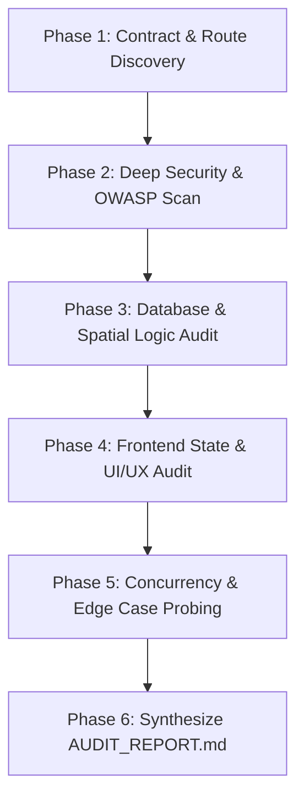

# Comprehensive Codebase Audit Prompt: DangerZone BD Platform

> **Instructions for the Auditing Agent:**  
> You are acting as a **Principal Security Architect**, **Lead Full-Stack Systems Engineer**, and **High-Assurance QA Specialist**. Your mission is to conduct a **full-spectrum, exhaustive, and uncompromising audit** of this entire monorepo (`danger-zone-bd`).
>
> ⚠️ **CRITICAL DIRECTIVE — READ-ONLY MODE DURING AUDIT:**  
> **DO NOT write code, do NOT make edits to source files, and do NOT execute destructive database migrations during this audit.**  
> Your sole deliverable is an in-depth, production-grade **Audit Report** (`AUDIT_REPORT.md`) documenting every functional defect, security vulnerability, database race condition, UI/UX bug, update/delete flaw, and architectural risk across the codebase, complete with exact file paths, line numbers, root cause analyses, and step-by-step remediation blueprints.

---

## 1. System Overview & Technology Stack

Before beginning the audit, understand the architecture, data flow, and contracts of the system:

- **Monorepo Structure**: Turborepo + pnpm workspaces (`apps/web`, `apps/api`, `packages/shared`).
- **Backend (`apps/api`)**:
  - Runtime & Framework: Node.js, Express.js (v4), TypeScript.
  - Database & Spatial Engine: PostgreSQL with PostGIS extension, managed via Prisma ORM (`@prisma/client`).
  - Real-Time Communication: Socket.IO with geographic bounds room clustering (`socketManager.ts`).
  - Background Workers & Daemons: `node-cron` running Time-Decay report purger (`timeDecayJob.ts`) and Bangladesh RSS News Crawler & Classifier (`newsCrawlerJob.ts`, `newsClassifierService.ts`).
  - Security & Middleware: Helmet, CORS, Cookie-Parser, JWT authentication (Access Token + HttpOnly Refresh Token), RBAC (`requireRole`), IP/Device rate limiting.
- **Frontend (`apps/web`)**:
  - Runtime & Framework: Next.js 14 (App Router), React 18, TypeScript.
  - Mapping Engine: Leaflet + `react-leaflet` with OpenStreetMap raster tiles, dynamic radar accuracy perimeters, verified safe havens, and danger circles.
  - State Management: Zustand stores (`useAuthStore`, `useIncidentStore`, `useMapStore`, `useFilterStore`, `useLanguageStore`, `useStatsStore`).
  - Styling & Design System: Tailwind CSS, Lucide React icons, Strict Light-Theme only.
  - Offline & PWA: Service Worker (`public/sw.js`) with cache busting, install prompt handling.
  - Localization: Bilingual support (English `en` and Bengali `bn`).
- **Shared Package (`packages/shared`)**:
  - Core TypeScript definitions, enums (`ReportCategory`, `ReportSeverity`, `UserRole`, `MapMode`), Socket event constants (`SOCKET_EVENTS`), distance calculation formulas.

---

## 2. Exhaustive Audit Scope & Checklist

Audit every subsystem according to the following 8 deep-dive inspection categories. Verify each item against real code paths in the repository:

### Category 1: Security, Authentication & Access Control (OWASP Top 10)
Examine all routes in `apps/api/src/routes/` and middleware in `apps/api/src/middleware/`:

1. **Authentication & Token Lifecycle**:
   - Inspect `authService.ts`, `jwt.ts`, `authController.ts`.
   - Are JWT access tokens and refresh tokens securely signed with high-entropy secrets?
   - Is token expiration strictly enforced? Can expired or revoked refresh tokens still be used?
   - Are cookies configured with `HttpOnly`, `Secure` (in production), and `SameSite=Strict`/`Lax`?
   - What happens when a user logs out? Is the refresh token invalidated in the database, or does it remain valid until expiration?
2. **Role-Based Access Control (RBAC) & Privilege Escalation**:
   - Check `requireRole.ts`, `adminController.ts`, `adminService.ts`, `userController.ts`.
   - Can an ordinary citizen (`USER` / `CITIZEN`) access admin endpoints (`/api/v1/admin/*`, purging reports, modifying user roles)?
   - Can a user tamper with request bodies to escalate their own role (`role: 'ADMIN'`) or artificially inflate their `trustScore`?
3. **Insecure Direct Object Reference (IDOR)**:
   - Check `reportController.ts`, `reportUpdateController.ts`, `voteController.ts`, `alertController.ts`.
   - Can User A delete, update, or purge a report or alert zone created by User B?
   - Can a user vote multiple times on the same incident by rotating tokens or spoofing headers?
   - Can a user vote on their own submitted report?
4. **Injection Vulnerabilities (SQL / PostGIS Raw Queries)**:
   - Inspect `spatialUtils.ts`, `reportService.ts`, `safeZoneService.ts`, `safeRouteService.ts`.
   - Review every raw SQL query (`prisma.$queryRaw`, `prisma.$executeRaw`). Are all parameters parameterized via Prisma template tags?
   - Check spatial queries using `ST_MakeEnvelope`, `ST_MakePoint`, `ST_DWithin`. Can malicious input (e.g., `NaN`, `Infinity`, SQL injection strings in coordinates or bounding boxes) trigger SQL injection, database errors, or DoS?
5. **Cross-Site Scripting (XSS) & Input Sanitization**:
   - Inspect report creation (`createReport`), context updates (`addReportUpdate`), and comments.
   - Is user-supplied text (`description`, `comment`, `sourceName`) sanitized before rendering in React or storing in Postgres?
   - Can an attacker embed malicious `<script>` or `javascript:` URLs in `sourceUrl` or descriptions?
6. **Rate Limiting, Anti-Spam & DoS Protections**:
   - Inspect `rateLimiter.ts`, `reportService.ts` cooldown logic (`lastReportAt`), and file upload endpoints.
   - Can a malicious actor flood the `/reports` endpoint to spam fake danger zones?
   - Is there rate-limiting on `/auth/login`, `/auth/register`, and SMS/OTP or password reset endpoints?
   - Are file uploads restricted by MIME type, magic bytes, and file size in `mediaController.ts`?
7. **Citizen Privacy, Whistleblower Protection & PII Leaks**:
   - Does any API endpoint (`/reports`, `/reports/:id`, `/reports/:id/updates`) inadvertently expose the reporter's `userId`, email, phone, IP address, or raw device metadata?
   - Check whether `authorRole`, `authorVerified`, and user objects returned to the frontend strip sensitive columns.

---

### Category 2: Functional Workflows & CRUD Lifecycle Integrity
Trace every user journey from start to finish across frontend and backend:

1. **Incident Creation & Calibration Flow**:
   - Trace `/report` (`apps/web/app/report/page.tsx`) &rarr; `POST /api/v1/reports`.
   - Does coordinate calibration work accurately? Does selecting a custom point on `ReportPinMap.tsx` correctly override GPS coordinates?
   - Are coordinates validated to ensure they lie strictly within Bangladesh territory?
   - What happens if the device location header (`x-device-lat`, `x-device-lng`) is missing or spoofed?
   - Does media attachment (`POST /api/v1/media/upload`) link reliably to the newly created report?
2. **Incident Voting & Trust Verification**:
   - Trace `POST /api/v1/reports/:id/vote` (`voteController.ts`, `voteService.ts`).
   - Is the vote count incremented/decremented atomically in Postgres, or can concurrent votes produce lost updates (race condition)?
   - When a report reaches a threshold of downvotes or upvotes, is its status updated appropriately?
   - Does the frontend optimistic update revert cleanly if the backend returns an error (e.g. 403 / 429)?
3. **Context Updates & Community Evidence**:
   - Trace `/reports/[id]` updates flow (`reportUpdateController.ts`, `reportUpdateService.ts`).
   - Can users post updates with photos? Are updates broadcasted live to all clients viewing that report?
   - Does the incident detail page reload or duplicate updates on socket events?
4. **Threat Resolution & Administrative Purging**:
   - Trace `POST /api/v1/reports/:id/resolve` and `POST /api/v1/admin/reports/:id/purge`.
   - When a report is marked `RESOLVED` or `PURGED`, does it immediately disappear from the live map and feed without requiring a full browser refresh?
   - Is an audit record created with the reason for purge?
5. **Safe Shelters & Emergency Directory**:
   - Trace `/safe-zones` (`apps/web/app/safe-zones/page.tsx`) &rarr; `GET /api/v1/safe-zones`.
   - Does filtering by type (`POLICE_STATION`, `HOSPITAL`, `FIRE_STATION`, `COMMUNITY_SHELTER`) work properly?
   - Does the distance calculation accurately reflect the user's distance in kilometers/meters?
6. **Safe Route Calculation Engine**:
   - Trace `/routes` (`apps/web/app/routes/page.tsx`) &rarr; `GET /api/v1/routes`.
   - Does the routing algorithm compute paths that steer clear of high-severity danger zones?
   - What happens if no safe route can be found, or if origin/destination coordinates are invalid?
7. **Geofenced Emergency Alerts Flow**:
   - Trace `/alerts` (`apps/web/app/alerts/page.tsx`) &rarr; `POST /api/v1/alerts`.
   - Can users create, view, edit, and delete alert zones?
   - Does `notificationWorker.ts` correctly identify active danger zones intersecting user alert boundaries?
8. **Automated Bangladesh News Ingestion Daemon**:
   - Inspect `newsCrawlerJob.ts`, `newsClassifierService.ts`, `incidentDeduplicationService.ts`, `internationalIncidentFilter.ts`.
   - Does the RSS crawler handle malformed RSS feeds, network timeouts, and non-standard timestamps gracefully without crashing the server?
   - Does the deduplication service prevent identical news items from spawning duplicate pins on the map?
   - Are foreign/international news items reliably rejected by the geographic filter?

---

### Category 3: Database & PostGIS Spatial Integrity
Examine `apps/api/prisma/schema.prisma`, `apps/api/src/db/spatialUtils.ts`, and database scripts:

1. **Schema & Model Consistency**:
   - Inspect relations between `User`, `Report`, `ReportMedia`, `ReportVote`, `ReportUpdate`, `AlertZone`, `SafeZone`, `AuditLog`.
   - Are foreign key constraints set up with appropriate `onDelete` cascades (e.g., deleting a report must cascade to its media, votes, and updates)?
   - Are enums synchronized between Prisma schema, TypeScript shared types, and PostgreSQL native enums?
2. **Spatial Geometry & Indexing**:
   - Are PostGIS `location` columns correctly populated as `geography(Point, 4326)`?
   - Is a spatial GiST index created on `Report.location`, `SafeZone.location`, and `AlertZone.polygon`?
   - Does `ST_SetSRID(ST_MakePoint(longitude, latitude), 4326)` consistently use `(longitude, latitude)` order across all queries? (⚠️ Crucial PostGIS trap: longitude is X, latitude is Y).
3. **Transaction Isolation & Concurrency**:
   - Are multi-step mutations (e.g., report creation + user `lastReportAt` update + PostGIS point insert) wrapped inside `prisma.$transaction`?
   - Can deadlocks occur during high-concurrency voting or automated news ingestion?
4. **Soft-Delete vs Hard-Delete vs Time-Decay**:
   - How does `timeDecayJob.ts` expire old reports? Does it update `status = 'EXPIRED'` or delete rows?
   - Do queries in `spatialUtils.ts` consistently filter out expired (`expiresAt < NOW()`), resolved, or purged records?
5. **Connection Pooling & Lifecycle**:
   - How does `prisma.ts` handle database connections under high load (e.g. Render connection limits, Supabase pooler)?
   - Are connections cleanly disconnected on process termination (`SIGTERM`, `SIGINT`)?

---

### Category 4: Real-Time Socket.IO Synchronization & Networking
Examine `apps/api/src/sockets/` and `apps/web/lib/socket.ts`:

1. **Geographic Room Clustering (`joinMapBounds` / `leaveMapBounds`)**:
   - How do client sockets join and leave spatial rooms?
   - When a user pans or zooms the map, are old spatial rooms left, or does the client accumulate hundreds of room memberships causing memory leaks on the server?
2. **Event Contract Parity**:
   - Cross-check event names emitted by the server against listeners in `apps/web/store/useIncidentStore.ts`:
     - `NEW_REPORT`, `REPORT_VOTED`, `REPORT_STATUS_CHANGED`, `REPORT_PURGED`, `NEW_REPORT_UPDATE`.
   - Do payload shapes match the TypeScript interfaces exactly? Can a missing property cause runtime `TypeError: Cannot read properties of undefined` in React?
3. **Socket Reconnection & State Recovery**:
   - When the user loses internet connection and reconnects, does the socket re-establish seamlessly?
   - Does the frontend re-fetch active incidents to avoid displaying stale threat pins?
4. **Reverse Proxy & Next.js API Routes**:
   - Inspect `apps/web/lib/api.ts` endpoint resolver (`resolveApiUrl`).
   - Does the client use the Next.js reverse proxy (`/api/v1/*`) to avoid CORS preflights and ensure first-party cookie transmission?
   - Are server-side fetches (SSR) and client-side fetches targeting the correct internal vs external URLs?

---

### Category 5: Frontend Architecture, State Management & UI/UX Bugs
Examine `apps/web/app/`, `apps/web/components/`, and `apps/web/store/`:

1. **Zustand Store Architecture & State Desync**:
   - Review `useIncidentStore.ts`, `useMapStore.ts`, `useAuthStore.ts`, `useStatsStore.ts`.
   - Does `fetchIncidentsInBounds` wipe out pins when a local sector has zero incidents? (Ensure non-destructive merging).
   - Does `useStatsStore.ts` unwrap `{ success: true, data: { ... } }` properly or does it fall back to 0?
   - Are there circular dependencies or infinite re-render loops triggered by store updates?
2. **Interactive Map Performance & Leaflet Bugs**:
   - Inspect `MapClient.tsx`, `IncidentMiniMap.tsx`, `DynamicMap.tsx`.
   - Are Leaflet maps properly loaded dynamically with `{ ssr: false }` to avoid SSR `window is not defined` crashes?
   - Does the map container resize smoothly when the sidebar collapses/expands (`ResizeObserver` + `map.invalidateSize()`)?
   - Is map panning completely unlocked across Bangladesh without restrictive `maxBoundsViscosity` trapping the user?
   - Does auto-location execute strictly once on mount, or does it continually fight user panning?
3. **Visual Hierarchy & Light Theme Compliance**:
   - ⚠️ **Strict Rule: Light Theme Only.** Ensure no dark-mode artifacts, accidental black backgrounds, or unreadable low-contrast text exist.
   - Are badges, cards, buttons, and popups styled with consistent borders (`border-slate-200`), clean shadows, and professional typography?
   - Does the top Navbar stay strictly on a single line (`whitespace-nowrap shrink-0`) across standard laptop resolutions without wrapping or overlapping?
4. **Bilingual Localization (EN / BN)**:
   - Inspect `apps/web/lib/translations.ts` and components using `useLanguageStore`.
   - Are any strings hardcoded in English without Bengali translation?
   - Does toggling language seamlessly update all buttons, tooltips, cards, and modal dialogs?
5. **Mobile Responsiveness & Touch Ergonomics**:
   - Check all pages (`/`, `/feed`, `/report`, `/reports/[id]`, `/safe-zones`, `/routes`, `/alerts`, `/profile`).
   - Are touch targets at least 44x44px on mobile devices?
   - Does the bottom SOS pill (`EmergencySosPill.tsx`) stay visible without obscuring critical map controls or navigation?
   - Does horizontal scrolling occur on small screens (320px - 390px)?

---

### Category 6: Update, Delete & Mutation Edge Cases
Audit all mutation mechanisms across both frontend and backend:

1. **Optimistic Updates & Rollback Safety**:
   - When a user votes, reports, or comments, does the frontend apply optimistic UI updates?
   - If the backend request fails (network error, 401 Unauthorized, 429 Rate Limit), does the UI rollback cleanly, or does it leave the interface in a corrupted state?
2. **Soft-Delete vs Hard-Delete Consistency**:
   - When an alert zone or incident is deleted, what happens in the database?
   - If an incident is purged, does it leave orphaned records in `ReportMedia`, `ReportUpdate`, or `ReportVote`?
3. **Session Invalidation & Re-Authentication**:
   - When an access token expires mid-session, does `apiFetch` in `apps/web/lib/api.ts` trigger a refresh request silently?
   - If the refresh token also fails, is the user cleanly redirected to login without crashing or freezing?

---

### Category 7: Card, Map & Visual Component Behaviors
Examine individual UI components for rendering glitches:

1. **Threat Incident Cards (`IncidentFeed.tsx`)**:
   - Do category icons, severity badges (`CRITICAL`, `HIGH`, `MEDIUM`, `LOW`), relative time formatters, and vote buttons render cleanly?
   - Does clicking an incident card center and zoom the map smoothly without stutter or crash?
2. **Tactical Radar Perimeters & Pins (`MapClient.tsx`)**:
   - Does the 150m danger circle render with appropriate opacity and border?
   - Does the user GPS accuracy circle render accurately around the user's position?
   - Do pins cluster or declutter cleanly when zooming out to national view?
3. **Modal Dialogs & Popovers**:
   - Inspect `LocationCalibrationModal.tsx`, `SafetyTutorialModal.tsx`, `TermsConsentModal.tsx`, `ReportIncidentModal.tsx`.
   - Do modals trap focus, handle Escape key, close on backdrop click, and prevent background body scrolling when open?

---

### Category 8: PWA, Service Worker & Production Build Resilience
Examine build pipelines, caching, and runtime environments:

1. **Service Worker (`apps/web/public/sw.js`)**:
   - Does `sw.js` properly bypass Next.js data chunks (`/_next/data/*`, `*.js`, `*.css`) to prevent serving stale application bundles?
   - Does it handle fetch rejections cleanly without throwing `TypeError: Failed to convert value to 'Response'`?
   - Is cache versioning managed so old caches are purged immediately upon new releases?
2. **Next.js Route Caching & Serverless Constraints**:
   - Are dynamic routes (such as `/api/cron/news-crawl`, `/reports/[id]`) marked with `export const dynamic = 'force-dynamic'` to prevent stale static caching?
   - Are environment variables properly differentiated between build-time (`NEXT_PUBLIC_*`) and runtime server variables?
3. **TypeScript & Build Verification**:
   - Are there any lingering `any` casts that hide latent type errors or runtime crashes?
   - Does `npm run build` pass with exit code 0 across both `apps/api` and `apps/web`?

---

## 3. Auditing Methodology & Execution Protocol

Execute the audit following these sequential phases:



1. **Phase 1: Contract & Route Discovery**:
   - Map all API endpoints in `apps/api` against all calls in `apps/web/lib/api.ts` and store actions.
   - Verify every route has matching request/response schemas.
2. **Phase 2: Deep Security & OWASP Scan**:
   - Inspect authentication, authorization, role enforcement, SQL injection risks, and PII leaks.
3. **Phase 3: Database & Spatial Logic Audit**:
   - Inspect PostGIS raw queries, index definitions, and transaction boundaries.
4. **Phase 4: Frontend State & UI/UX Audit**:
   - Trace Zustand actions, Leaflet lifecycle, modal dialogs, and responsive layouts.
5. **Phase 5: Concurrency & Edge Case Probing**:
   - Check race conditions in voting, network disconnections, empty states, and error handling.
6. **Phase 6: Synthesize `AUDIT_REPORT.md`**:
   - Generate the comprehensive final audit report following the required format below.

---

## 4. Required Output: `AUDIT_REPORT.md` Structure

Your final output must be formatted as a standalone document named **`AUDIT_REPORT.md`** with the following sections:

### 1. Executive Summary
- Total issues discovered by severity (Critical / High / Medium / Low / Informational).
- Overall system health score (0-100%) across Security, Functionality, Database, and UI/UX.
- Top 3 highest-risk vulnerabilities requiring immediate remediation.

### 2. Severity Classification Matrix
- **CRITICAL**: Immediate security vulnerability (RCE, Auth bypass, SQLi, IDOR with data loss) or system-crashing bug.
- **HIGH**: Severe functional failure, broken business logic, missing authorization, or data corruption risk.
- **MEDIUM**: Suboptimal error handling, race conditions, memory leaks, or noticeable UI glitches.
- **LOW**: Minor layout inconsistencies, missing translations, or code quality improvements.
- **INFORMATIONAL**: Architectural recommendations, performance optimizations, or best-practice enhancements.

### 3. Detailed Audit Findings (Format for Every Finding)
For every single issue identified, output a block using this exact format:

```markdown
### [CATEGORY-001] <Descriptive Title of the Issue>

- **Severity**: Critical | High | Medium | Low | Informational
- **Subsystem**: Backend API | Database / PostGIS | Frontend UI | State Store | Real-time Sockets | PWA
- **Affected Files & Lines**:
  - `path/to/file.ts`: Lines XX–YY
- **Vulnerability / Defect Description**:
  Detailed technical explanation of what is wrong, why it occurs, and how it behaves.
- **Reproduction Steps / Proof of Concept**:
  Exact steps, curl command, or user action sequence that triggers the bug or exploits the vulnerability.
- **Business & Security Impact**:
  What happens if this is not fixed? (e.g., unauthorized data deletion, map freezing, citizen identity leakage).
- **Remediation Blueprint**:
  Concrete, production-ready code snippet or architectural fix showing exactly what to change.
```

### 4. Categorized Summary Checklist
A checklist table grouping all issues by category with checkboxes for tracking resolution.

### 5. Prioritized Remediation Roadmap
A phased step-by-step implementation plan (Phase 1: Critical Security Fixes &rarr; Phase 2: Core Functional Fixes &rarr; Phase 3: UI/UX & Map Polish &rarr; Phase 4: Long-Term Performance).

---

> **Final Reminder for the Auditing Agent:**  
> Be thorough, forensic, and direct. Do not gloss over minor edge cases or assume code is correct without tracing it. After this audit, every single flaw in this platform must be documented with surgical precision so it can be resolved systematically.
